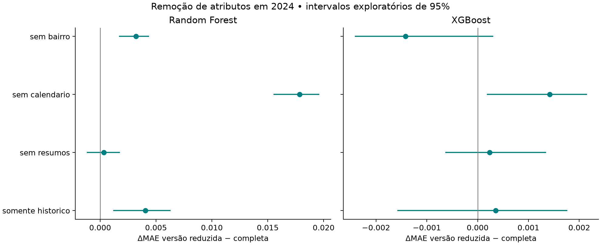
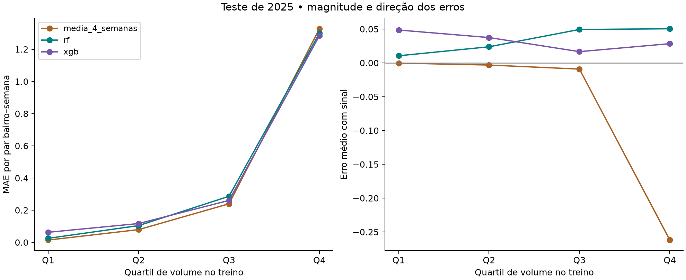
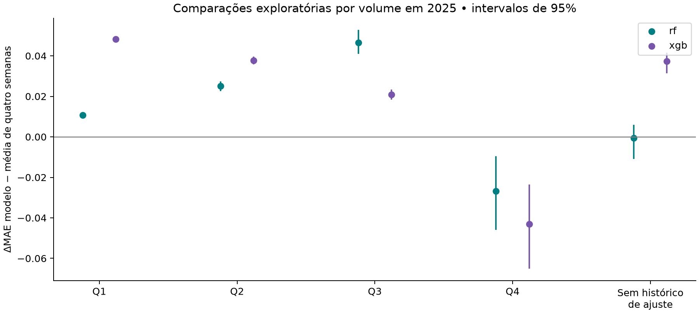

# Análises complementares de atributos e erros por volume

Protocolo registrado em 2026-11-16T23:35:28.717410+00:00, antes das execuções complementares.

**Análises exploratórias posteriores ao conhecimento dos resultados principais.** 2024 já orientou a escolha dos parâmetros; 2025 já foi examinado. Não há nova confirmação independente, mudança da seleção original ou demonstração causal. Os dados são exclusivamente SSP-SP.

## Contribuição dos atributos em 2024

Dez ajustes, mantendo parâmetros e janela de 84 dias. Mesmos pares e alvos disponíveis na validação original. Cada versão completa foi retreinada e comparada às previsões originais. Não houve nova busca de parâmetros.

| Modelo | Versão | MAE | RMSE | Ajuste e previsão em segundos |
|---|---|---:|---:|---:|
| rf | completa | 0.472923 | 1.432973 | 611.4 |
| rf | sem_bairro | 0.476131 | 1.433664 | 224.9 |
| rf | sem_calendario | 0.490766 | 1.435936 | 505.9 |
| rf | sem_resumos | 0.473260 | 1.427124 | 303.3 |
| rf | somente_historico | 0.476971 | 1.434371 | 137.4 |
| xgb | completa | 0.481137 | 1.422726 | 3.2 |
| xgb | sem_bairro | 0.479721 | 1.425731 | 2.6 |
| xgb | sem_calendario | 0.482553 | 1.432199 | 3.0 |
| xgb | sem_resumos | 0.481372 | 1.431366 | 2.9 |
| xgb | somente_historico | 0.481493 | 1.438404 | 2.5 |

Média de quatro semanas na mesma população: MAE 0.469178; RMSE 1.532870.

| Modelo | Remoção | ΔMAE versus completa | Intervalo exploratório de 95% |
|---|---|---:|---|
| rf | sem_bairro | +0.003208 | [+0.001693; +0.004379] |
| rf | sem_calendario | +0.017843 | [+0.015518; +0.019603] |
| rf | sem_resumos | +0.000337 | [-0.001186; +0.001773] |
| rf | somente_historico | +0.004048 | [+0.001164; +0.006314] |
| xgb | sem_bairro | -0.001417 | [-0.002417; +0.000309] |
| xgb | sem_calendario | +0.001416 | [+0.000183; +0.002155] |
| xgb | sem_resumos | +0.000235 | [-0.000637; +0.001346] |
| xgb | somente_historico | +0.000356 | [-0.001583; +0.001764] |

ΔMAE positivo indica piora ao retirar entradas; negativo indica melhora. São comparações condicionais às configurações escolhidas para a versão completa. Os grupos são correlacionados; os resumos derivam do histórico. Remover colunas pode mudar as divisões das árvores e não mede causalidade nem importância universal. Uma única semente não mede estabilidade entre sementes. Não se escolhe uma nova versão vencedora.

## Composição dos grupos de volume em 2025

Quartis reconstruídos a partir dos alvos disponíveis no treino e conferidos contra os rótulos originais. Não se usou o volume futuro para definir grupos. Empates podem tornar os grupos desiguais.

| Grupo | Bairros | Pares | Registros observados | Alvos zero |
|---|---:|---:|---:|---:|
| Q1 | 631 | 32181 | 243 | 99.3% |
| Q2 | 485 | 24735 | 1080 | 95.9% |
| Q3 | 559 | 28509 | 4239 | 87.0% |
| Q4 | 557 | 28407 | 99637 | 45.5% |
| sem_historico_ajuste | 99 | 2604 | 17 | 99.4% |

## Erros por volume

| Modelo | Grupo | MAE | RMSE | Erro médio com sinal | Parcela do erro absoluto | Parcela do erro quadrático |
|---|---|---:|---:|---:|---:|---:|
| media_4_semanas | Q1 | 0.014457 | 0.099357 | -0.000350 | 1.0% | 0.1% |
| media_4_semanas | Q2 | 0.079240 | 0.238586 | -0.003214 | 4.2% | 0.7% |
| media_4_semanas | Q3 | 0.239863 | 0.445052 | -0.009199 | 14.5% | 2.6% |
| media_4_semanas | Q4 | 1.327287 | 2.699251 | -0.261986 | 80.1% | 96.5% |
| media_4_semanas | sem_historico_ajuste | 0.041955 | 0.125766 | +0.029666 | 0.2% | 0.0% |
| rf | Q1 | 0.025196 | 0.092433 | +0.010483 | 1.7% | 0.1% |
| rf | Q2 | 0.104273 | 0.224074 | +0.023782 | 5.3% | 0.6% |
| rf | Q3 | 0.286431 | 0.422890 | +0.049399 | 16.8% | 2.7% |
| rf | Q4 | 1.300494 | 2.553946 | +0.050402 | 76.0% | 96.5% |
| rf | sem_historico_ajuste | 0.041298 | 0.090956 | +0.029094 | 0.2% | 0.0% |
| ultima_semana | Q1 | 0.013051 | 0.118251 | -0.001740 | 0.7% | 0.1% |
| ultima_semana | Q2 | 0.072165 | 0.282141 | -0.010633 | 3.2% | 0.5% |
| ultima_semana | Q3 | 0.227402 | 0.531811 | -0.033919 | 11.5% | 2.0% |
| ultima_semana | Q4 | 1.683353 | 3.702640 | -0.881367 | 84.5% | 97.4% |
| ultima_semana | sem_historico_ajuste | 0.035714 | 0.191003 | +0.022657 | 0.2% | 0.0% |
| xgb | Q1 | 0.062744 | 0.103228 | +0.048567 | 4.1% | 0.2% |
| xgb | Q2 | 0.117009 | 0.223477 | +0.037449 | 5.9% | 0.6% |
| xgb | Q3 | 0.260813 | 0.413472 | +0.016595 | 15.2% | 2.6% |
| xgb | Q4 | 1.284257 | 2.548559 | +0.028390 | 74.4% | 96.6% |
| xgb | sem_historico_ajuste | 0.079206 | 0.111285 | +0.067354 | 0.4% | 0.0% |
| zero | Q1 | 0.007551 | 0.090058 | -0.007551 | 0.2% | 0.0% |
| zero | Q2 | 0.043663 | 0.221541 | -0.043663 | 1.0% | 0.1% |
| zero | Q3 | 0.148690 | 0.436706 | -0.148690 | 4.0% | 0.3% |
| zero | Q4 | 3.507481 | 8.625642 | -3.507481 | 94.7% | 99.7% |
| zero | sem_historico_ajuste | 0.006528 | 0.085419 | -0.006528 | 0.0% | 0.0% |

Erro com sinal é previsão menos observado: positivo indica superestimação média. As parcelas de erro usam o total de cada método como denominador. Diferem de participação nos registros.

| Modelo | Grupo | ΔMAE versus média | Intervalo exploratório de 95% |
|---|---|---:|---|
| rf | Q1 | +0.010738 | [+0.009295; +0.012105] |
| rf | Q2 | +0.025033 | [+0.022565; +0.027463] |
| rf | Q3 | +0.046568 | [+0.040981; +0.052785] |
| rf | Q4 | -0.026793 | [-0.046015; -0.009542] |
| rf | sem_historico_ajuste | -0.000657 | [-0.010988; +0.005897] |
| xgb | Q1 | +0.048287 | [+0.047777; +0.048997] |
| xgb | Q2 | +0.037769 | [+0.035827; +0.039636] |
| xgb | Q3 | +0.020950 | [+0.018296; +0.023422] |
| xgb | Q4 | -0.043031 | [-0.065118; -0.023590] |
| xgb | sem_historico_ajuste | +0.037251 | [+0.031447; +0.041582] |

## Diagnóstico dos zeros e rastreabilidade

O arquivo volume/diagnostico_zero_positivo.csv separa alvos observados zero e positivos por método e grupo. É retrospectivo: não permite escolher uma estratégia sabendo de antemão se a semana terá registro. Os arquivos erros_por_semana.csv e erros_por_bairro.csv permitem localizar concentrações de erro sem selecionar casos favoráveis.

## Inferência e limitações

Mil reamostragens pareadas em blocos de quatro semanas avaliadas, com todos os bairros de cada semana. Os mesmos sorteios foram usados dentro de cada fase. Intervalos percentis de 95% são aproximações exploratórias, sem correção por multiplicidade; não são intervalos de previsão ou comprovação confirmatória. A dependência espacial e a escolha do bloco limitam a inferência. Semanas sem pares num grupo têm denominador zero; sorteios com denominador total zero são descartados e contabilizados. Os calendários e eventuais lacunas estão nos arquivos conferencia.json.

Não se ajustou uma política de seleção por bairro. Não se treinaram ablações em 2025 ou 2026. Subnotificação, instabilidade dos rótulos de bairro e registro como proxy de publicação continuam limitando o estudo.

## Ajuste técnico documentado

O adendo de representação, registrado antes dos ajustes somente históricos, garante matrizes CSR em todas as versões. Isso evita que a remoção das categorias altere também a representação dos zeros para XGBoost. Os três primeiros ajustes de RF já usavam CSR e foram preservados. Um ajuste sem resumos ainda não concluído foi interrompido e refeito. O código inicial e o registro original estão preservados; parâmetros, grupos de atributos, hipóteses e métricas permaneceram os mesmos.

## Integridade

82 arquivos do experimento original conferidos por SHA256 antes e depois. As previsões e os parâmetros originais permaneceram intactos. Registro, verificações e manifestos de saída acompanham esta pasta.
