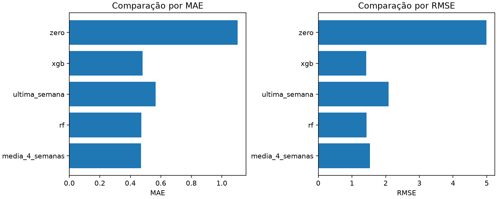
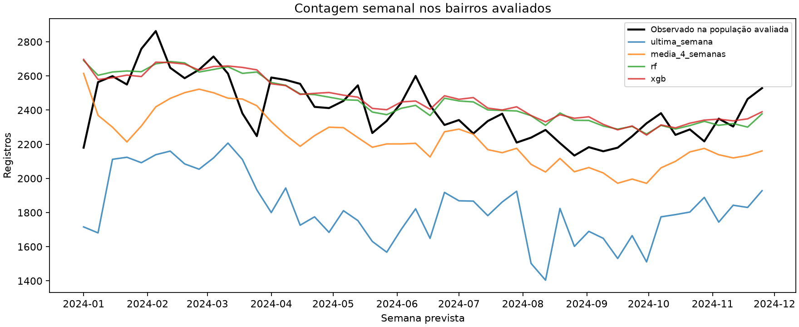
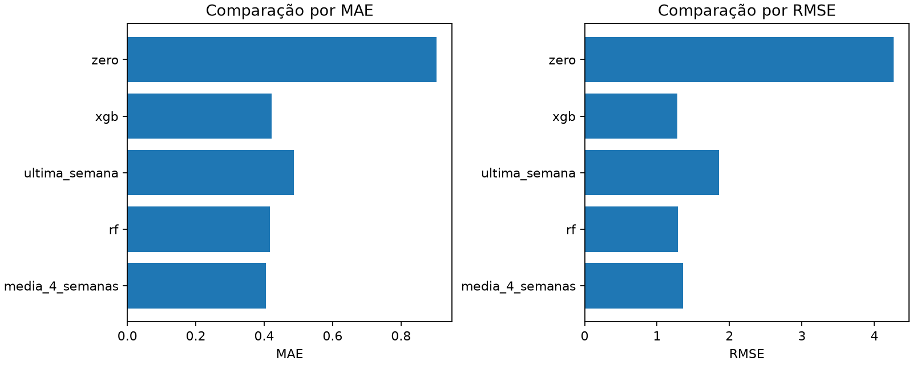
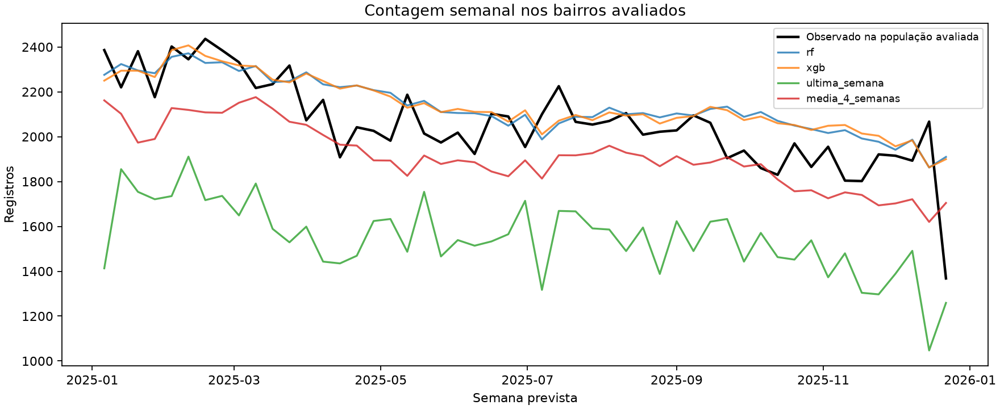
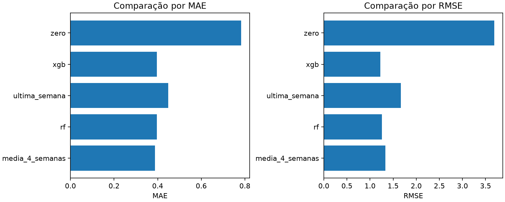
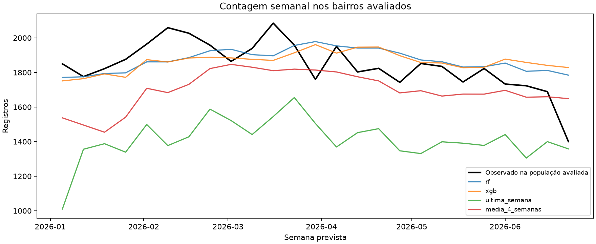

# Previsão semanal de registros de roubo

SSP-SP, município da ocorrência São Paulo. Alvo: registros por natureza criminal, não crimes únicos ou risco individual. Sem integração socioeconômica.

## Protocolo

Modelos globais fixos em cada ano, com entradas atualizadas semanalmente. Cortes de ajuste em 01/01/2024, 01/01/2025 e 01/01/2026. Alvos de ajuste reconstruídos na data de corte e semanas com pelo menos 28 dias de maturação. Bairro e mês codificados exclusivamente no ajuste. Previsões negativas truncadas em zero, sem arredondamento.

Seleção: 48 semanas de 2024, com rótulos disponíveis antes de 01/01/2025 e maturação de 28 dias. Vencedor pré-teste: **rf**; referência pré-teste: **media_4_semanas**. Nenhuma escolha é alterada pelos resultados de teste.

## Configurações selecionadas

- rf: janela 84 dias; parâmetros `{"criterion": "squared_error", "max_depth": null, "max_features": 1.0, "min_samples_leaf": 5, "n_estimators": 200}`.
- xgb: janela 84 dias; parâmetros `{"colsample_bytree": 0.8, "device": "cpu", "learning_rate": 0.05, "max_depth": 6, "min_child_weight": 10, "n_estimators": 400, "objective": "reg:squarederror", "reg_lambda": 1, "subsample": 0.8, "tree_method": "hist"}`.

## validacao

| Modelo | Exemplos | MAE | RMSE |
|---|---:|---:|---:|
| media_4_semanas | 104714 | 0.469178 | 1.532870 |
| rf | 104714 | 0.472923 | 1.432973 |
| ultima_semana | 104714 | 0.565273 | 2.086686 |
| xgb | 104714 | 0.481137 | 1.422726 |
| zero | 104714 | 1.103549 | 4.993667 |

## teste

| Modelo | Exemplos | MAE | RMSE |
|---|---:|---:|---:|
| media_4_semanas | 116436 | 0.404317 | 1.356921 |
| rf | 116436 | 0.417453 | 1.283875 |
| ultima_semana | 116436 | 0.486104 | 1.853529 |
| xgb | 116436 | 0.421150 | 1.280749 |
| zero | 116436 | 0.903638 | 4.267479 |

Diferença de MAE do vencedor pré-selecionado para a referência pré-selecionada: 0.013137. Não houve redução de MAE nesta população; configurações foram mantidas.

## avaliacao_2026

| Modelo | Exemplos | MAE | RMSE |
|---|---:|---:|---:|
| media_4_semanas | 58876 | 0.388159 | 1.329987 |
| rf | 58876 | 0.395818 | 1.254212 |
| ultima_semana | 58876 | 0.448264 | 1.669699 |
| xgb | 58876 | 0.396737 | 1.221428 |
| zero | 58876 | 0.782305 | 3.689994 |

Diferença de MAE do vencedor pré-selecionado para a referência pré-selecionada: 0.007659. Não houve redução de MAE nesta população; configurações foram mantidas.

IC aproximado de 95% da diferença de MAE no teste: [0.007071, 0.018147], por 1.000 reamostragens em blocos de quatro semanas. Diferenças negativas favorecem o modelo. Blocos seguem as semanas avaliadas, incluindo eventuais intervalos de calendário excluídos.

## Limitações e leitura dos resultados

- A data de registro é proxy da disponibilidade pública; não há snapshots históricos completos das versões dos boletins.
- A margem de 28 dias reduz a incompletude dos alvos de ajuste, sem eliminá-la. As proporções de atraso nos metadados consideram apenas registros já disponíveis no corte.
- Alvos de teste são retrospectivos no snapshot de 16/10/2026. As diferenças para os rótulos provisórios usados na seleção devem ser consideradas ao comparar fases.
- Bairros ainda desconhecidos na origem ficam fora dos exemplos e são quantificados na auditoria semanal. Categorias conhecidas na origem, mas ausentes do ajuste, continuam avaliadas e têm métricas próprias.
- Quartis de volume usam somas dos alvos disponíveis do treino; limites empatados podem produzir faixas vazias. Não são taxas populacionais.
- As somas nos gráficos abrangem a população de bairros avaliados; não representam necessariamente o total municipal completo.
- Em 2026, as semanas com menos de 28 dias até 30/06 são marcadas como recentes e avaliadas também separadamente; mesmo as anteriores podem ter registros tardios ausentes.
- Resultados mostram associação preditiva no recorte; não explicam causas da criminalidade nem garantem desempenho em outros períodos.

As previsões, métricas por grupo, tempos, versões, hashes e verificação de reprodução estão nos arquivos de cada fase e em selecao.json. Pesos dos modelos ficam locais nas subpastas models e podem ser reconstruídos com os mesmos comandos.
